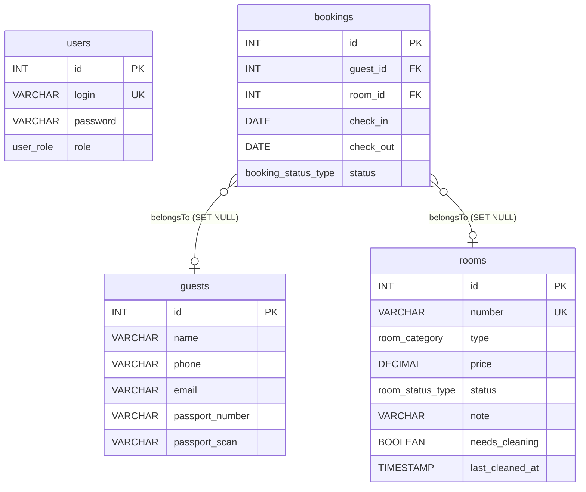

# DATABASE — HMS

Структура базы данных PostgreSQL. Источник истины: `schema.sql`.

[↩ На главную](../docs/PRODUCT.md) · [ARCHITECTURE](ARCHITECTURE.md) · [API](API.md)

---

## Общая информация

| Параметр | Значение |
|----------|----------|
| **СУБД** | PostgreSQL 14+ |
| **Имя БД** | `hotel` |
| **Кодировка** | `UTF8` |
| **Драйвер** | `pg` (promise API) |
| **Подключение** | Connection pool (10 соединений) |

**DDL-скрипт:** `schema.sql` в корне проекта. Применяется командой:
```bash
psql -U <user> -d hotel -f schema.sql
```
Скрипт идемпотентен — использует `CREATE TABLE IF NOT EXISTS` и `ON CONFLICT DO NOTHING`, повторный запуск безопасен.

---

## Таблица: users

**Назначение:** Учётные записи для входа в систему.

| Поле | Тип | Nullable | Default | Key | Описание |
|------|-----|----------|---------|-----|----------|
| id | INT (AUTO_INCREMENT) | Нет | — | **PK** | Уникальный идентификатор |
| login | VARCHAR(50) | Нет | — | UNIQUE | Имя пользователя |
| password | VARCHAR(64) | Нет | — | — | SHA-256 хеш пароля (hex) |
| role | ENUM('admin','user') | Нет | 'user' | — | Роль пользователя |

**Индексы:**
- PRIMARY KEY (`id`)
- UNIQUE (`login`)

**Сид-данные:** одна запись `admin` / пароль `admin` (хешируется через `SHA2('admin', 256)` прямо в DDL).

**Запросы из кода:**
```sql
SELECT id, login, role FROM users WHERE login = $1 AND password = $2
INSERT INTO users (login, password, role) VALUES ($1, $2, $3)
```

**⚠️ Замечание:** Пароли хранятся как SHA-256 хеш без соли (см. SECURITY.md). Поле `name` (отображаемое имя) в схеме отсутствует — если понадобится, добавлять через `ALTER TABLE`.

---

## Таблица: rooms

**Назначение:** Номерной фонд гостиницы.

| Поле | Тип | Nullable | Default | Key | Описание |
|------|-----|----------|---------|-----|----------|
| id | SERIAL | Нет | — | **PK** | Уникальный идентификатор |
| number | VARCHAR(10) | Нет | — | UNIQUE | Номер комнаты (строка, напр. "101") |
| type | room_category ENUM | Нет | — | — | Тип номера |
| price | DECIMAL(10,2) | Нет | — | — | Цена за ночь в ₽ |
| status | room_status_type ENUM | Нет | 'свободен' | — | Текущий статус |
| note | VARCHAR(500) | Да | NULL | — | Примечание (например, причина недоступности) |
| needs_cleaning | BOOLEAN | Нет | FALSE | — | Флаг, требует уборки |
| last_cleaned_at | TIMESTAMP | Да | NULL | — | Дата последней уборки |

**Индексы:**
- PRIMARY KEY (`id`)
- UNIQUE (`number`)

**Статусы номеров:** `свободен`, `занят`, `недоступен`

**Цены по умолчанию (frontend-константы, не хранятся в БД):**
- "Одноместный" — 3000₽/ночь
- "Двухместный" — 4000₽/ночь
- "Полулюкс" — 5000₽/ночь
- "Люкс" — 7500₽/ночь

**Сид-данные:** 8 номеров (101, 102, 201, 202, 103, 203, 301, 104).

**Запросы из кода:**
```sql
SELECT * FROM rooms                    -- GET /api/rooms
SELECT * FROM rooms WHERE id = $1      -- GET /api/rooms/:id
INSERT INTO rooms (number, type, price, status, note) VALUES ($1, $2, $3, $4, $5)
UPDATE rooms SET number=$1, type=$2, price=$3, status=$4, note=$5 WHERE id=$6
DELETE FROM rooms WHERE id = $1
SELECT COUNT(*) FROM rooms             -- stats
SELECT COUNT(*) FROM rooms WHERE status='свободен'  -- stats
SELECT * FROM rooms WHERE id = $1 FOR UPDATE  -- при бронировании
UPDATE rooms SET status='занят' WHERE id=$1      -- при бронировании
UPDATE rooms SET status='свободен', needs_cleaning=TRUE WHERE id=$1   -- при отмене
UPDATE rooms SET needs_cleaning=FALSE, last_cleaned_at=NOW() WHERE id=$1  -- отметить убранным
```

---

## Таблица: guests

**Назначение:** База гостей с паспортными данными.

| Поле | Тип | Nullable | Default | Key | Описание |
|------|-----|----------|---------|-----|----------|
| id | INT (AUTO_INCREMENT) | Нет | — | **PK** | Уникальный идентификатор |
| name | VARCHAR(200) | Нет | — | — | ФИО полностью |
| phone | VARCHAR(20) | Да | NULL | — | Телефон |
| email | VARCHAR(100) | Да | NULL | — | Email |
| passport_number | VARCHAR(20) | Да | NULL | — | Серия и номер паспорта |
| passport_scan | VARCHAR(500) | Да | NULL | — | Путь к файлу скана |

**Индексы:**
- PRIMARY KEY (`id`)
- Индекс на `passport_number` в схеме не задан

**Сид-данные:** 6 гостей.

**Запросы из кода:**
```sql
SELECT * FROM guests
SELECT * FROM guests WHERE name LIKE $1 OR phone LIKE $2 OR passport_number LIKE $3 OR email LIKE $4
SELECT * FROM guests WHERE id = $1
INSERT INTO guests (name, phone, email, passport_number, passport_scan) VALUES ($1, $2, $3, $4, $5)
UPDATE guests SET name=$1, phone=$2, email=$3, passport_number=$4, passport_scan=$5 WHERE id=$6
DELETE FROM guests WHERE id = $1
```

---

## Таблица: bookings

**Назначение:** Бронирования (связь гостей и номеров).

| Поле | Тип | Nullable | Default | Key | Описание |
|------|-----|----------|---------|-----|----------|
| id | SERIAL | Нет | — | **PK** | Уникальный идентификатор |
| guest_id | INT | Да | NULL | **FK → guests(id)** | Ссылка на гостя |
| room_id | INT | Да | NULL | **FK → rooms(id)** | Ссылка на номер |
| check_in | DATE | Нет | — | — | Дата заезда |
| check_out | DATE | Нет | — | — | Дата выезда |
| status | booking_status_type ENUM | Нет | 'активна' | — | Статус брони |

**Индексы:**
- PRIMARY KEY (`id`)
- FOREIGN KEY (`guest_id`) → `guests(id)` **ON DELETE SET NULL**
- FOREIGN KEY (`room_id`) → `rooms(id)` **ON DELETE SET NULL**

**Сид-данные:** 3 бронирования, подставляются через `SELECT ... FROM guests, rooms WHERE ...` по имени гостя и номеру комнаты.

**Запросы из кода:**
```sql
SELECT b.*, g.name AS guest_name, r.number AS room_number, r.type AS room_type, r.price AS room_price
FROM bookings b
LEFT JOIN guests g ON b.guest_id = g.id
LEFT JOIN rooms  r ON b.room_id = r.id
ORDER BY b.id DESC                          -- GET /api/bookings

INSERT INTO bookings (guest_id, room_id, check_in, check_out, status) VALUES ($1, $2, $3, $4, $5)

SELECT COUNT(*) FROM bookings WHERE status='активна'  -- stats

UPDATE bookings SET status='отменена' WHERE id=$1      -- cancel
```

**⚠️ Замечание:** В schema.sql даты хранятся как DATE/TIMESTAMP. Формат `ДД.ММ.ГГГГ` используется на уровне API для обмена данными с клиентом.

**⚠️ FK-поведение:** `ON DELETE SET NULL` означает, что удаление гостя или номера с существующими бронями **не блокируется** — вместо этого `guest_id`/`room_id` в связанных бронированиях обнуляется, а сама бронь остаётся в таблице с "осиротевшей" ссылкой. Это соответствует I-006 в KNOWN_ISSUES.md, но механизм иной, чем предполагалось ранее (там был описан риск dangling reference без FK вообще — на деле FK есть, просто мягкий).

---

## ER-диаграмма



---

## Связи

| Связь | Тип | Описание |
|-------|-----|----------|
| bookings → guests | N-1, SET NULL | Бронь принадлежит одному гостю; при удалении гостя ссылка обнуляется |
| bookings → rooms | N-1, SET NULL | Бронь привязана к одному номеру; при удалении номера ссылка обнуляется |
| rooms ↔ bookings | 1-N | Номер может быть в нескольких бронях (история) |
| guests ↔ bookings | 1-N | Гость может иметь несколько броней |

## Статусы

### Статусы номеров (rooms.status)

| Статус | Описание |
|--------|----------|
| свободен | Номер доступен для бронирования |
| занят | Номер забронирован |

**⚠️ В схеме не предусмотрено:** статусы "уборка", "ремонт" — ENUM ограничен двумя значениями. Расширение потребует `ALTER TABLE ... MODIFY COLUMN`.

### Статусы бронирований (bookings.status)

| Статус | Описание |
|--------|----------|
| активна | Действующая бронь |
| отменена | Отменённая бронь |
| завершена | Завершённая бронь (выезд). Не выставляется автоматически нигде в коде — статус зарезервирован в ENUM, но не используется бизнес-логикой. |

---

## Известные ограничения текущей схемы

| Ограничение | Описание | Приоритет исправления |
|--------------|----------|------------------------|
| Даты как VARCHAR | `check_in`/`check_out` не сортируются хронологически | Высокий |
| Нет индекса на passport_number | Поиск гостей по паспорту — полное сканирование таблицы | Средний |
| SET NULL вместо RESTRICT | Удаление гостя/номера с активной бронью тихо портит данные брони | Высокий |
| Нет поля created_at/updated_at | Невозможно отследить когда запись создана/изменена | Средний |
| ENUM для типов номеров | Добавление нового типа требует миграции схемы, а не INSERT | Низкий |

**Для получения точной структуры БД в реальном окружении:** выполнить `SHOW CREATE TABLE rooms;` и аналогичные команды — например, чтобы проверить фактически применённую collation или движок хранения (не специфицирован явно в `schema.sql`, MySQL использует InnoDB по умолчанию).